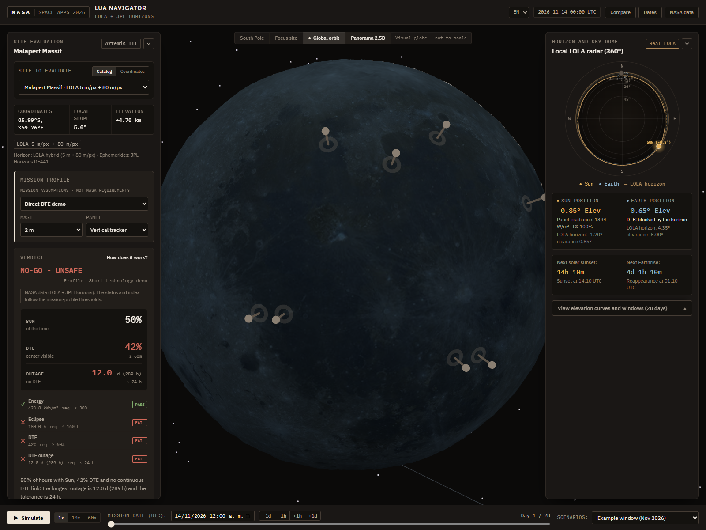
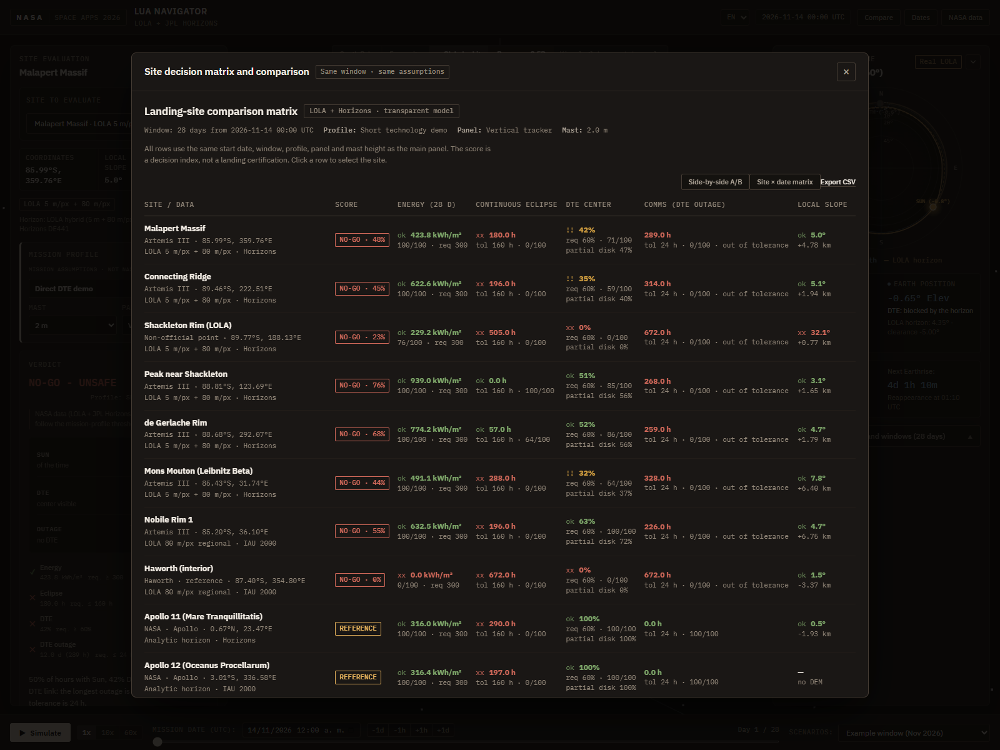
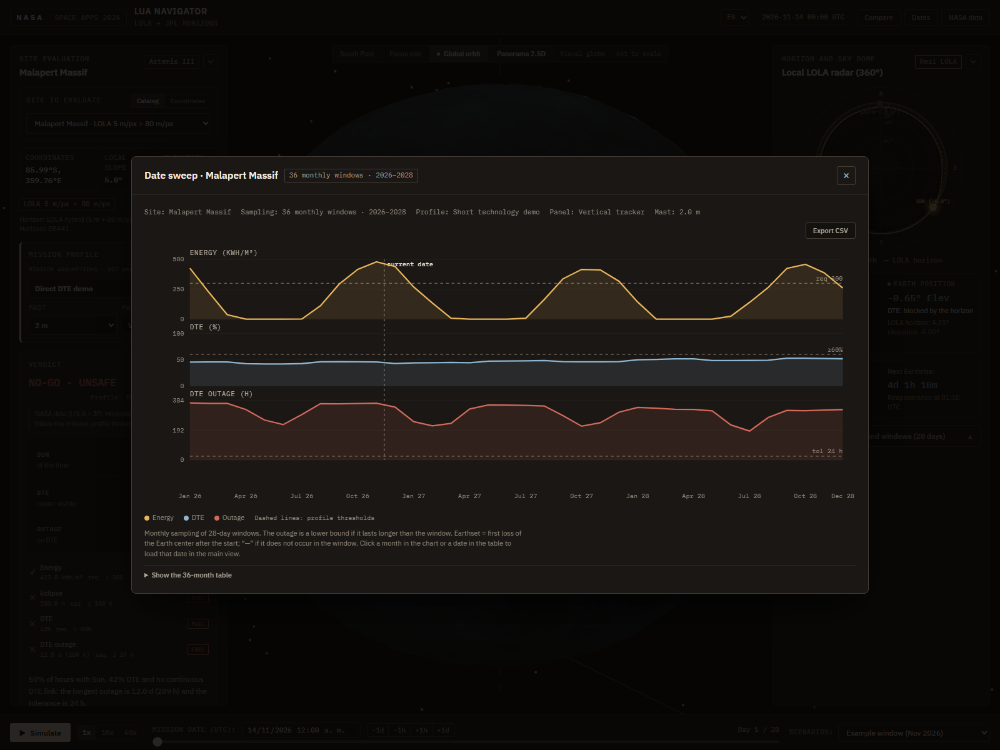
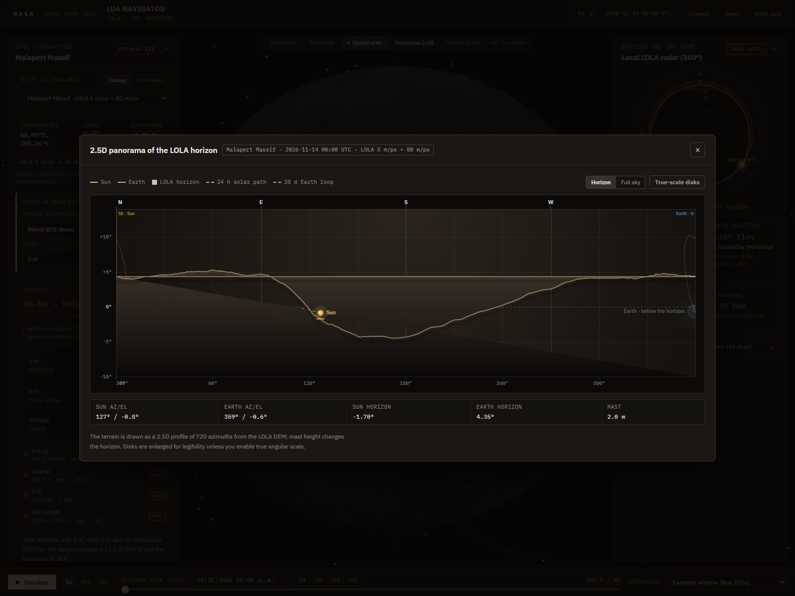
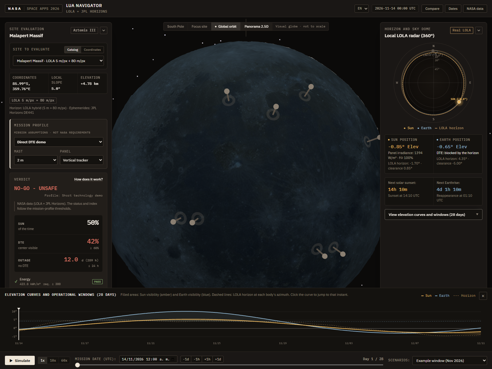

# Lua Navigator

**Web app de apoyo a decisiones que compara sitios y fechas de alunizaje en el polo sur lunar usando topografía real LOLA de NASA y efemérides JPL Horizons.**

NASA Space Apps Challenge 2026 · [Read in English](README.md)

**Demo en vivo: <https://lua-navigator.vercel.app>**

Lua Navigator convierte datos de terreno y efemérides de NASA en una comparación sitio/fecha rápida y
auditable: luz solar, eclipses, visibilidad directa a Tierra (DTE), cortes de comunicaciones,
pendiente y un índice multicriterio transparente. Es software educativo y de apoyo a decisiones,
**no** un análisis de aterrizaje certificado para vuelo.

## El problema

Las misiones al polo sur lunar enfrentan restricciones extremas de iluminación y comunicaciones. Una
cresta de pocos grados de altura puede decidir si un módulo de aterrizaje obtiene energía solar,
enlace directo a Tierra, ambos o ninguno. Las herramientas existentes (QuickMap, Moon Trek, Horizons)
están pensadas para análisis detallados, no para comparar escenarios con rapidez. Cuando se retrasa
una fecha de lanzamiento, los planificadores necesitan reevaluar sitios y fechas ágilmente.

## Qué incluye

- **Elige un sitio y una fecha**: 28 sitios curados — ocho polares (Malapert, Connecting Ridge,
  Shackleton, Peak near Shackleton, de Gerlache, Mons Mouton, Nobile, Haworth), trece históricos
  (Apollo 11–17, Luna 9/16/17/21, Chang'e 3/5/6), cuatro CLPS/comerciales (IM-1 Odysseus, IM-2
  Athena, Blue Ghost 1, IM-3 Reiner Gamma) y tres referencias internacionales (Chandrayaan-3, SLIM,
  Chang'e 4) — o coordenadas lunares personalizadas. El selector los agrupa por categoría.
- **Ve el Sol y la Tierra contra el horizonte LOLA real**: panorama 2.5D del horizonte, radar polar y
  línea de tiempo de elevación Sol/Tierra de 28 días.
- **Lee primero un veredicto en lenguaje claro**: porcentaje de horas con Sol, porcentaje de tiempo
  con el centro de la Tierra visible (DTE), el corte DTE continuo más largo y un índice de misión
  secundario.
- **Ejecuta un barrido de fechas (launch slip)**: 36 ventanas mensuales de 28 días entre 2026 y 2028,
  con energía, DTE, corte máximo y próximo Earthset. Un clic carga esa fecha en la vista principal.
- **Compara sitios con los mismos supuestos**: matriz de comparación de 28 sitios con energía,
  eclipse, DTE, comunicaciones/corte, pendiente y un score multicriterio transparente.
- **A/B lado a lado**: dos escenarios sitio/fecha con radares LOLA compactos, veredictos, métricas,
  tabla de deltas B−A y “cargar en vista principal” para cualquiera de los dos.
- **Matriz sitio × fecha**: 28 sitios × 36 meses con selector de métrica (score, Sol, DTE, corte);
  las filas de referencia están marcadas. Un clic en una celda carga ese sitio y esa fecha.
- **Comparte y exporta**: el escenario se codifica en la URL y se copia con **Compartir**; exporta
  JSON del escenario (con la serie de 672 puntos) y CSV de la comparación, el barrido y la matriz.
- **Guía educativa**: **¿Cómo funciona?** abre un inicio rápido bilingüe, definiciones de métricas,
  por qué el polo sur es difícil, un glosario, ejemplos “prueba esto” y límites.
- **Explora perfiles de misión**: demo DTE directo, rover nocturno, puesto tripulado,
  relé/store-and-forward y un perfil personalizado. Todos los pesos y umbrales son visibles.
- **Define tus propios umbrales**: el perfil personalizado permite fijar requisitos de energía,
  eclipse, DTE y corte. La herramienta recalcula el sitio actual, la comparación, el barrido y la
  matriz. Cumplir los cuatro umbrales es GO. En modo estricto (por defecto), cualquier umbral
  incumplido es NO-GO; sin modo estricto, un umbral incumplido es PRECAUCIÓN cuando el índice es ≥50;
  si no, NO-GO.
- **UI bilingüe**: inglés por defecto con selector EN/ES; la elección se conserva localmente.

Los horizontes LOLA y las efemérides de JPL Horizons son datos de NASA/JPL. Los umbrales y pesos de
los perfiles predefinidos son supuestos del equipo, **no requisitos NASA**; los umbrales
personalizados son supuestos del usuario. La métrica de energía es irradiancia acumulada en el plano
del panel, no un presupuesto eléctrico completo.

## Capturas

| Panel principal | Comparación de sitios |
|:---:|:---:|
| [](docs/screenshots/01-dashboard.png) | [](docs/screenshots/02-comparison.png) |
| Veredicto, radar LOLA, globo 3D y dock de misión. | 28 sitios bajo la misma ventana, perfil y supuestos. |

| Barrido de fechas | Panorama 2.5D del horizonte |
|:---:|:---:|
| [](docs/screenshots/03-sweep.png) | [](docs/screenshots/04-panorama.png) |
| 36 ventanas mensuales de 2026 a 2028. | Terreno LOLA, trayectoria solar y bucle de libración terrestre. |

**Línea de tiempo de 28 días** — ventanas de visibilidad Sol/Tierra frente al horizonte LOLA.

[](docs/screenshots/05-timeline.png)

## Uso de inteligencia artificial (SI)

Este proyecto usó un asistente de codificación con IA de la familia Gemini como apoyo al desarrollo:
redacción y refactorización de código, tests, documentación y scripts de generación de datos
derivados. La idea del reto, el alcance científico, la selección de sitios, los perfiles de misión y
la interpretación de resultados fueron definidos por el equipo; la IA no se usó para concebir la
solución. Los DEM LOLA y las efemérides de JPL Horizons son datos auténticos de NASA/JPL; no se
generaron mediciones con IA. No se incluyen imágenes, vídeos ni audio generados con IA.

La declaración completa está en [`docs/SI_USAGE.es.md`](docs/SI_USAGE.es.md) (English:
[`docs/SI_USAGE.md`](docs/SI_USAGE.md)). `package.json` y `public/data/manifest.json` incluyen
`siDisclosure`, y cada JSON derivado de `public/data` incluye un objeto `si`.

## Datos NASA y validación

| Fuente | Uso |
|---|---|
| NASA PGDA LOLA 5 m/px landing-site DEMs | Horizonte de campo cercano para seis sitios |
| NASA PGDA LOLA 80S 80 m/px regional DEM | Campo lejano hasta 100 km; solo Nobile, Haworth, IM-1 e IM-2 |
| NASA/JPL Horizons DE441 | Azimut, elevación y distancia aparentes topocéntricas Sol/Tierra, paso de 1 h |
| NASA LRO / ASU LROC QuickMap | Enlaces oficiales y texturas de vista previa |
| NASA Solar System Treks (Moon Trek) | Enlaces oficiales y capas LOLA |

- Horizontes: 720 bins de azimut (0.5°), cinco alturas de mástil (0.5, 2, 5, 10, 20 m) y corrección
  por curvatura lunar.
- Efemérides: JPL Horizons DE441, 2026-01-01 a 2029-02-01, interpolación cúbica de Hermite en el
  navegador.
- Validación: 4.032 muestras fuera de malla contra Horizons; **RMS 5e-6°** (la UI muestra 1e-5°),
  error máximo **1.22e-4°** (la UI muestra 1.2e-4°).
- Validación cruzada del terreno: `public/data/terrain-validation.json` compara el DEM de 5 m/px de
  campo cercano con el DEM regional de 80 m/px en el rango de campo cercano de cada sitio (24
  azimuts, mástil de 2 m). RMS agregado 0.51°, máximo 2.18° en 144 comparaciones. Mide la
  concordancia entre productos, no la precisión absoluta; ambos derivan de LOLA.
- Procedencia del azimut: los horizontes híbridos heredados usaban como “norte” la dirección hacia el
  polo sur lunar. Se rotaron 180° (360 bins) para que el bin 0 sea el norte geográfico y coincida con
  los azimuts de Horizons; el ajuste queda registrado en el manifiesto y en las notas de cada
  horizonte.
- Nobile, Haworth, IM-1 e IM-2 usan el DEM regional de 80 m/px y el motor IAU 2000 local para las
  efemérides; la UI lo etiqueta. IM-1 está cerca del borde norte del DEM 80S, por lo que el relieve
  lejano hacia el norte puede estar subrepresentado.
- Los sitios históricos, internacionales y CLPS/comerciales no polares usan horizontes analíticos
  planos y el motor IAU 2000 local; se etiquetan `REFERENCE` y no son candidatos Artemis III.
- Las texturas del globo 3D son solo vistas previas, y las esferas Sol/Tierra de la escena 3D son
  ilustrativas y no están a escala. El análisis usa los horizontes LOLA y las efemérides Horizons, no
  las texturas.
- **Referencias internacionales** (Chandrayaan-3, SLIM, Chang'e 4) usan coordenadas reales de misión
  pero **no** topografía LOLA en esos puntos: su horizonte es analítico plano y sus efemérides son el
  motor IAU 2000 local. Se etiquetan `REFERENCE` y no se clasifican como candidatos. Chang'e 4 está
  en la cara oculta, así que su DTE es 0% y requiere un relé; Chandrayaan-3 a 69.4°S es una
  simplificación porque la iluminación polar depende del terreno.
- **Manifiesto de datos**: `public/data/manifest.json` lista 70 archivos derivados con tamaños y
  checksums SHA-256. El manifiesto incluye `referenceSitesNote` para las referencias internacionales.
  Los DEM originales (~0.5 GB) no se distribuyen.

## Inicio rápido

Pruébalo en línea en **<https://lua-navigator.vercel.app>**, o ejecútalo localmente:

```bash
npm install
npm run dev
# http://localhost:5173
```

Build de producción:

```bash
npm run build
npm run preview
```

Regenerar el barrido mensual y el manifiesto de datos (opcional; los archivos generados están
versionados):

```bash
npm run data:sweep
npm run data:flat-horizons
npm run data:manifest
```

Tests de regresión (motor, catálogo, datos, i18n y exportación):

```bash
npm test
```

## Documentación

- **Referencia de features:** [Español](docs/features.es.md) · [English](docs/features.md)
- **Declaración de uso de IA (SI):** [Español](docs/SI_USAGE.es.md) · [English](docs/SI_USAGE.md)
- **Manifiesto de datos y checksums:** `public/data/manifest.json`
- La UI de la aplicación usa inglés por defecto y permite cambiar a español con el selector EN/ES;
  la elección se conserva localmente. La página de submission y el README principal están en inglés.

## Estructura del proyecto

| Ruta | Propósito |
|---|---|
| `index.html` | Shell de página única: header, panel de veredicto, radar, timeline, dock y modales |
| `src/main.js` | Estado de la aplicación, controles, estado de URL, cableado de compartir/exportar |
| `src/analysis/` | Geometría del horizonte, muestreo, scoring y lógica de estado |
| `src/ephemeris/` | Decodificación/interpolación Horizons y fallback IAU 2000 local |
| `src/topography/` | Catálogo de sitios, búsqueda de horizontes y helpers localizados |
| `src/render/` | Renderizado del globo lunar 3D |
| `src/ui/` | Radar, timeline, panorama, comparación, barrido, matriz, A/B y guía |
| `src/i18n.js`, `src/i18n-static.js` | Mensajes EN/ES y traducción del HTML estático |
| `src/export.js` | Serialización JSON/CSV y descargas |
| `public/data/` | Sitios, horizontes, efemérides, barridos, validación y manifiesto |
| `scripts/` | Generación de datos y mantenimiento del manifiesto |
| `tests/` | Tests de análisis, catálogo, sitios personalizados, datos, i18n, exportación y SI |

## Limitaciones

Es software de apoyo a decisiones y educativo, **no flight-certified**. No modela rocas por debajo de
la resolución del DEM, estado térmico, baterías, movilidad del rover, constelaciones de relé ni un
punto de aterrizaje certificado. El horizonte es un perfil 1D por azimut; el panorama 2.5D es una
representación sombreada. `gMaxHours` es una cota inferior porque se mide dentro de una ventana de 28
días. Nobile, Haworth, IM-1 e IM-2 usan terreno regional de 80 m/px; las coordenadas personalizadas
usan el horizonte LOLA real del sitio más cercano a ≤10 km o un horizonte plano. Las referencias
internacionales usan horizontes analíticos planos e IAU 2000 local; son contexto, no análisis LOLA.
El globo 3D y las esferas Sol/Tierra son ilustrativos y no están a escala. La cobertura de efemérides
es 2026-01-01 a 2029-02-01. El score es un índice de decisión, no una probabilidad de éxito.

## Referencias

- NASA PGDA LOLA 5 m/px landing-site DEMs: https://pgda.gsfc.nasa.gov/data/LOLA_5mpp/
- NASA PGDA LOLA 80S 80 m/px regional DEM: https://pgda.gsfc.nasa.gov/products/90
- NASA/JPL Horizons System (DE441): https://ssd.jpl.nasa.gov/horizons/
- NASA LRO / ASU LROC QuickMap: https://quickmap.lroc.asu.edu/
- NASA Solar System Treks (Moon Trek): https://trek.nasa.gov/moon/
- Barker et al. (2021), Improved LOLA Elevation Maps for South Pole Landing Sites:
  https://doi.org/10.1016/j.pss.2020.105119
- Mazarico et al. (2011), Illumination conditions of the lunar polar regions using LOLA topography:
  https://doi.org/10.1016/j.icarus.2010.10.030

Este proyecto es independiente y no está avalado por NASA.
